<div align="center">

<picture>
  <source media="(prefers-color-scheme: dark)" srcset="assets/banner.svg">
  <source media="(prefers-color-scheme: light)" srcset="assets/banner-light.svg">
  
</picture>

[](LICENSE)
[](#安装)
[](#安装)
[](#安装)
[](https://uniqai.app/?utm_source=github&utm_medium=readme-zh-cn&utm_campaign=ugc-ad-director)

**AI UGC 广告脚本：2 秒钩子、分镜表、字幕、Kling / Veo 提示词、合规检查。**

[快速开始](#快速开始) · [工作原理](#工作原理) · [示例](#示例) · [安装](#安装) · [常见问题](#常见问题)

</div>

[English](README.md) · [Русский](README.ru.md) · 简体中文 · [Español](README.es.md) · [Português (BR)](README.pt-BR.md) · [日本語](README.ja.md) · [한국어](README.ko.md)

# ugc-ad-director：AI UGC 广告脚本与视频提示词

AI UGC 广告先有脚本，再有提示词。这个技能把一份产品简报变成 TikTok / Reels / Shorts 广告脚本：钩子落在前两秒之内，五个带时间的节拍（hook → problem → demo → proof → CTA，即钩子 → 痛点 → 演示 → 证明 → 行动号召），一份分镜表、屏幕字幕、旁白，以及每个镜头各自的提示词：给图像模型的、给 Kling 的、给带口播台词的 Veo 3 的。一个纯标准库的 Python 脚本负责检查结果，并拒绝那些不该上线的东西：像顾客一样说话的 AI 出镜人、没有来源的 "clinically proven"（临床验证）、缺失的 AI 标注。

它负责起草，不负责编造。出镜人是虚构的演示者，每条宣称都需要证据，`AI-generated ad` 标注从第一帧起就是一条字幕。伦理规则写在检查器里，而不是脚注里。

| **2.0 秒内抛出钩子** | **每个镜头、每个模型各一条提示词** | **不合规就构建失败** |
|:---|:---|:---|
| 最多十二个词，说出来的同时打上字幕，按品类从钩子库里挑选。 | 图生视频的首帧、一条 Kling 片段提示词、一条带对白的 Veo 3 提示词；出镜人的描述在各镜头之间保持一致。 | 虚假见证、平台背书、无依据的宣称和缺失的 AI 标注都是错误，不是警告。 |

## 快速开始

```bash
git clone https://github.com/uniqaiapp/ugc-ad-director && cd ugc-ad-director
python3 scripts/ugc_script.py lint examples/scripts/skincare-serum.json
python3 scripts/ugc_script.py render examples/scripts/skincare-serum.json --out serum.md
```

第一条命令打印 `ok, 0 errors, 0 warnings`；第二条写出一份脚本表，包含时间轴表格、旁白、字幕、镜头提示词、宣称和一份合规清单。在智能体里，只要说“给 <产品 URL> 写一条 30 秒的 UGC 广告”，技能就会根据你的简报做同样的事。

## 演示



## 工作原理

1. **简报 → 事实。** 从一个 URL 或一行文字里，技能提取出产品能做的那一件事、它面向谁、它消除了哪个烦恼，以及所有可核实的东西（标签、规格、界面截图）。其他的一概不要；"revolutionary"（革命性）不是事实。
2. **钩子优先。** 一个想法，≤ 12 个词，在 2.0 秒内落地，字幕和旁白同时出现，因为用户多半是静音刷的。[`references/hook-library.md`](references/hook-library.md) 按品类和类型（点名、反常识、结果先行、对比、观众现在就能做的测试）收录了钩子，还列出了应当避免的钩子。
3. **五个带时间的节拍。** hook → problem → demo → proof → cta，按 15、20、30、45 或 60 秒缩放（[`references/structure.md`](references/structure.md)）。演示最长，只展示一个动作。证明必须是可核实的东西，最好是真实产品的实拍或真实的屏幕录制，哪怕广告的其余部分都是生成的。
4. **镜头 → 提示词。** 每个镜头带有 `subject`、`action`、`camera`、`setting`、`lighting`、`negative`、`audio`。`scripts/ugc_script.py prompts` 把它们渲染成首帧静态图、一条 Kling 片段提示词（5 或 10 秒，负面提示词，不用慢动作）和一条把台词作为 `Dialogue` 的 Veo 3 提示词（[`references/model-prompts.md`](references/model-prompts.md)）。
5. **检查。** 时间轴连续且在 `duration_s` 处结束；钩子 ≤ 2 秒；节拍顺序正确；字幕每行 ≤ 48 个字符；每个镜头的旁白语速；每个生成镜头都有提示词；AI 出镜人配上第一人称顾客口吻是错误；"proven"、"guaranteed"、"#1"、百分比和 "results in N days" 必须放进 `claims` 并附证据；AI 标注必须出现在字幕里。完整列表见 [`references/script-format.md`](references/script-format.md)。

```
brief ──▶ hook ──▶ beats + timings ──▶ shots ──▶ script.json
                                                   │
                     lint (structure + compliance) ◀┘──▶ render (.md sheet) ──▶ prompts (image / kling / veo3)
```

本 README 引用的全部数字都来自 `python3 scripts/ugc_script.py stats examples/scripts/skincare-serum.json`：6 个镜头，钩子在 2 秒处结束，30 秒内 75 个词的旁白（2.5 词/秒），7 行字幕，最长 41 个字符，5 个生成镜头，2 条附证据的宣称。节拍切分和 3.5 词/秒的语速上限是可用的默认值，不是测出来的最优值；本仓库不对留存率或转化率作任何承诺。

## 示例

[`examples/`](examples/README.md) 里有横跨多个行业的十一份脚本：护肤品、一款饮食规划应用、一件厨房小工具、狗狗磨牙零食（真实顾客，已签授权书）、一门语言课程、B2B 开票软件、一款没有旁白的清洁喷雾、跑鞋、旅行 eSIM、咖啡订阅和一款宠物摄像头。每份渲染出的脚本表和提示词文件都已提交到仓库，并由测试逐字节复现。

<details>
<summary><b>从简报到脚本的前十秒（skincare-serum）</b></summary>

**改前**（简报）

```text
Dewline Barrier Serum: fragrance-free hydrating serum with ceramides and 2% niacinamide.
Audience: women 22-35 with dry, flaky skin under makeup. 30 s, AI presenter.
```

**改后**（`examples/rendered/skincare-serum.md` 里时间轴的前三行）

```text
| # | Time | Beat | Visual | Caption | Voiceover | Source |
|---|---|---|---|---|---|---|
| 1 | 0s–2s | hook | Close-up of a fingertip dragging foundation across dry, flaky cheek; product in the mirror | Your foundation isn't the problem. / AI-generated ad | Your foundation isn't the problem. | image-to-video |
| 2 | 2s–7s | problem | Presenter to camera, towel on hair, holding up a flaky makeup sponge | dry skin + makeup = cake | Dry skin drinks the water out of your makeup, so it cakes by lunch. | image-to-video |
| 3 | 7s–15s | demo | Two drops of serum pressed into the cheek with two fingers; skin goes from matte-flaky to even | two drops, press, don't rub | Two drops. Press it in with two fingers, don't rub. Ceramides fill the cracks, niacinamide calms the red. | image-to-video |
```

镜头 2 的 Veo 3 提示词（来自 `examples/prompts/skincare-serum.txt`）：

```text
fictional woman in her late twenties, towel wrapped on her head, no makeup, holding a makeup sponge toward the lens, small bathroom, white tiles.
Action: she talks to the camera and tilts the sponge to show dried foundation on it.
Camera: handheld selfie, eye level, slight sway.
Lighting: window daylight, no ring light.
Dialogue (on camera, natural pace): "Dry skin drinks the water out of your makeup, so it cakes by lunch."
Audio: room tone, faint bathroom echo.
Style: candid bathroom phone video, soft window light, visible pores and skin texture.
No subtitles, no captions, no logos in frame.
```

</details>

<details>
<summary><b>检查器会拒绝什么（examples/bad/fake-testimonial.json）</b></summary>

```text
error   hook: hook is 18 words; keep it under 13 so it lands inside 2 s
error   shot 1: hook shot ends at 3s; it must end by 2s
error   beats: missing beat(s): proof
error   shot 1: prompt is missing 'camera'
error   shot 1: reads as a first-person customer testimonial but the presenter is 'ai_generated': rewrite as a demo or a sourced claim
error   shot 2: reads as a first-person customer testimonial but the presenter is 'ai_generated': rewrite as a demo or a sourced claim
error   shot 3: implies a platform or third-party endorsement; remove it
error   claim 1: 'clinically proven' has no evidence; add a source, a test or remove the claim
error   shot 3: 'guaranteed' is a claim; list it under 'claims' with evidence or drop it
error   shot 3: 'doctor recommended' is a claim; list it under 'claims' with evidence or drop it
error   shot 4: '50%' is a claim; list it under 'claims' with evidence or drop it
error   compliance: ai_label is empty but the ad contains AI-generated footage or an AI presenter
examples/bad/fake-testimonial.json: failed, 12 errors, 8 warnings
```

这里省略了那八条警告（字幕长度、语速、未列出的数字、缺少平台开关、未描述出镜人）；`python3 scripts/ugc_script.py lint examples/bad/fake-testimonial.json` 会把它们全部打印出来。

</details>

<details>
<summary><b>新建一份脚本</b></summary>

```bash
python3 scripts/ugc_script.py new --vertical pets --product "Bitewell Chews" --duration 30 --presenter none > chews.json
# fill in visuals, captions, voiceover, prompts, claims; then
python3 scripts/ugc_script.py lint chews.json --strict
python3 scripts/ugc_script.py prompts chews.json --model veo3
```

</details>

在哪里渲染提示词：任何接受首帧加文字的图生视频工具都行。我们用 [UniqAI 的图生视频页面](https://uniqai.app/video/image-to-video?utm_source=github&utm_medium=readme-zh-cn&utm_campaign=ugc-ad-director) 来做，一张产品图就是一段片段的首帧；本仓库附带的 Kling 和 Veo 3 格式正是那里在用的格式。

## 安装

任何读取指令文件的智能体都能用，挑你自己的。Python 3.9+；无需安装任何包。

<details open>
<summary><b>Claude Code</b></summary>

```bash
# user-level
git clone https://github.com/uniqaiapp/ugc-ad-director ~/.claude/skills/ugc-ad-director
# or project-level
git clone https://github.com/uniqaiapp/ugc-ad-director .claude/skills/ugc-ad-director
```

然后在任意会话里输入 `/ugc-ad-director`，或者直接描述你要的广告；技能会根据自己的 `description` 自动触发。克隆时会把 `scripts/` 和 `references/` 一并带上，技能需要它们。

</details>

<details>
<summary><b>Cursor</b></summary>

把 [`SKILL.md`](SKILL.md)、`scripts/`、`references/` 和 [`.cursor/rules/ugc-ad-director.mdc`](.cursor/rules/ugc-ad-director.mdc) 复制到你的项目里。规则文件内嵌了技能本体。

</details>

<details>
<summary><b>Codex / 任何读取 AGENTS.md 的智能体</b></summary>

把 `SKILL.md`、`scripts/` 和 `references/` 复制到 `.agents/skills/ugc-ad-director/`，再把 [`codex/INSTRUCTIONS.md`](codex/INSTRUCTIONS.md) 里的片段加进你的 `AGENTS.md`。本仓库里的 [`AGENTS.md`](AGENTS.md) 是通用版本。

</details>

<details>
<summary><b>纯提示词</b></summary>

把 [`SKILL.md`](SKILL.md) 粘进任意模型的系统提示词，上下文允许的话再加上 `references/structure.md` 和 `references/compliance.md`。除 frontmatter 外，它没有任何智能体专属语法。检查器仍然需要 Python。

</details>

<details>
<summary><b>不用智能体</b></summary>

```bash
python3 scripts/ugc_script.py --help
```

`lint`、`render`、`prompts`、`stats` 和 `new` 都可以对任意脚本 JSON 独立运行。

</details>

## 常见问题

<details>
<summary><b>AI 出镜人可以说自己很喜欢这款产品吗？</b></summary>

不可以。AI 出镜人是演示者：它展示、解释、对比、提问。"I've been using this"（我一直在用）、"changed my life"（改变了我的生活）、"honest review"（真实测评）和 "not sponsored"（非广告）属于第一人称的顾客体验，出镜人是生成的或根本不存在时，这些就是捏造的见证。检查器会拒绝它们。签过授权书的真实顾客可以这么说；见 `examples/scripts/dog-dental-chews.json`。

</details>

<details>
<summary><b>真的必须把广告标注为 AI 生成吗？</b></summary>

技能会从第一帧起把 `AI-generated ad` 放进字幕，并要求打开平台的 AI 内容开关。TikTok、Meta 和 YouTube 各自都有针对逼真生成内容的披露规则，FTC 关于虚假评论和见证的规则涵盖了 AI 生成的人物，欧盟 AI 法案的透明度条款自 2026 年 8 月起适用。细节和日期见 [`references/compliance.md`](references/compliance.md)。上线前请阅读最新的政策页面；本仓库只做概述，不逐字引用。

</details>

<details>
<summary><b>提示词面向哪些模型？</b></summary>

每个生成镜头有三种输出：首帧静态图（任何图像模型都行）、Kling 风格的片段提示词（5 或 10 秒，带负面提示词）和 Veo 3 风格的提示词（台词作为对白，外加一行环境音）。片段长度和音频支持会随版本变化；这些模式写在 [`references/model-prompts.md`](references/model-prompts.md) 里，很容易改成 Runway、Wan 或 Seedance 的版本。

</details>

<details>
<summary><b>检查通过就能证明广告合规吗？</b></summary>

不能。它只能抓住它认识的错误：时间、语速、字幕长度、英文的见证和宣称措辞、缺失的标注、背书用语。它无法核实你的证据是否真实，读不懂其他语言，也不知道某个平台上周改了政策。它让低级错误无法发生，让其余问题一目了然。

</details>

<details>
<summary><b>为什么用 JSON 而不是文本脚本？</b></summary>

因为时间、字幕、宣称和提示词需要相互校验，而文档里的一张表格没法做检查。JSON 是源文件；`render` 给你可读的脚本表。

</details>

## 相关项目

- [video-director](https://github.com/uniqaiapp/video-director)：把一句话创意变成面向 AI 视频模型（Kling、Veo、Sora 等）的逐镜头提示词，附运镜、灯光和运动词汇表。广告需要电影感镜头而不是 UGC 风格时用它。
- [awesome-ai-video-prompts](https://github.com/uniqaiapp/awesome-ai-video-prompts)：精选并分类的 AI 视频模型提示词，附生成时用的参数。
- [no-plastic](https://github.com/uniqaiapp/no-plastic)：让 AI 人像看起来自然的提示词规则和检查器；可用于出镜人的首帧。
- [ai-video-pricing](https://github.com/uniqaiapp/ai-video-pricing)：人工核对的 AI 视频生成价格表，按秒和按片段计价，方便给分镜表做预算。

## 参与贡献

欢迎提 issue 和 pull request。改动尽量小，并在 PR 描述里附上改前/改后的示例。
本地检查方法见 [CONTRIBUTING.md](CONTRIBUTING.md)（`python3 tests/run.py`，无依赖）。

## 许可证

代码和示例：[MIT](LICENSE) © UniqAI；`references/` 采用 CC BY 4.0。

---

<div align="center">

<sub>由 <a href="https://uniqai.app/?utm_source=github&utm_medium=readme-zh-cn&utm_campaign=ugc-ad-director">UniqAI</a> 出品：Kling 3.0、Veo 3、Flux、Nano Banana 以及 GPT-5/Claude/Gemini/Grok，全在一个应用里。我们自己的广告初稿也是用这个技能写的。</sub>

</div>
